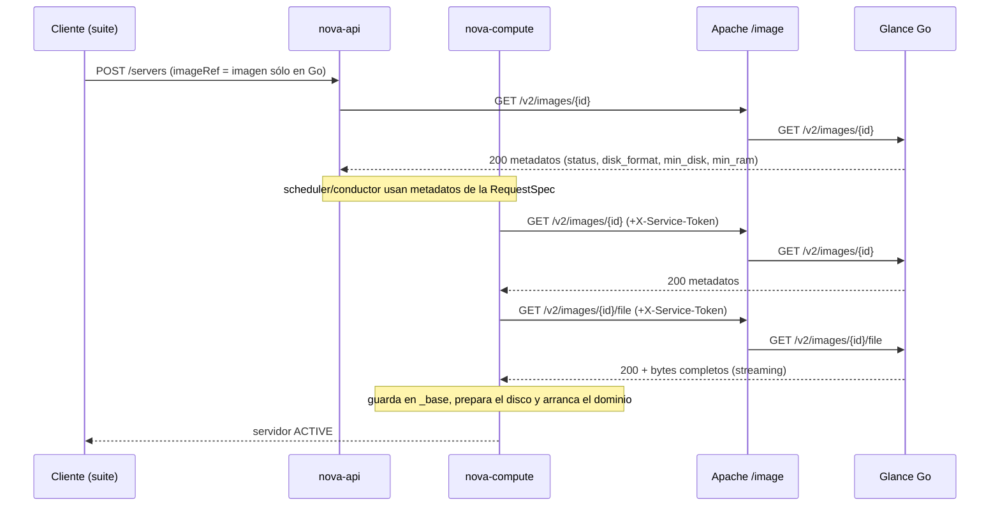

# Flujo de datos Nova → Glance: captura

Estado (2026-11-12): **flujo real capturado** en dos corridas de
[la suite B26](b26-integration-suite.md). El resultado y su diagrama están en la
[evidencia](../../evidence/sprint5/glance-b26-suite-20261112/README.md). En
resumen, Nova hizo tres lecturas de metadatos, dos del esquema `image` y una
descarga completa de 21 692 416 bytes desde Glance Go (123 ms en Go).

Diferencias con la hipótesis de abajo:
- Nova también pide `GET /v2/schemas/image`.
- El descubrimiento (`GET /`) no aparece porque nova-api lo guarda en caché.
- La presencia de `X-Service-Token` no se pudo observar, porque keystoneauth registra en WARN.

## Flujo esperado (a confirmar)



Puntos a verificar con la captura:
- Cuántas lecturas de metadatos hace cada servicio de Nova.
- Si nova-compute envía `X-Service-Token`, que es la autenticación compuesta documentada en [composite-auth.md](composite-auth.md).
- El tamaño de la descarga: tiene que ser igual al de la imagen.
- El tiempo que Glance Go dedica a la descarga dentro del boot.

## Cómo se captura

[`scripts/integration/glance_flow.py`](../../scripts/integration/glance_flow.py)
no modifica ningún servicio. Lee tres fuentes, acotadas a la ventana del boot:

1. **Glance Go (journald de su unidad)**. Hay un registro JSON por solicitud con `request_id`, método, ruta anonimizada, status, duración y bytes. Es la fuente autoritativa de lo que respondió Go.
2. **Nova (journald de n-api, n-cpu y conductores)**. Se buscan dos tipos de línea de keystoneauth:
   - `GET call to image for … used request id req-…`, que permite atribuir cada respuesta de Go al servicio exacto de Nova.
   - `REQ: curl …`, de la que sólo se conserva **si existen** las cabeceras `X-Auth-Token` y `X-Service-Token`, nunca su valor.
3. **Apache (`horizon_access.log`)**. Se usa como respaldo: oslo.log suele dejar `keystoneauth=WARN` y entonces las líneas del punto 2 no aparecen. En ese caso, cada respuesta de Go se empareja con la línea de Apache que tenga el mismo método, ruta y status (±2 s), y la presencia de `X-Service-Token` queda como **desconocida** (`null`), sin inferirla.

**Saneamiento.** Los UUID se sustituyen por plantillas de ruta (`/v2/images/{id}/file`). No se guardan tokens, hashes de tokens, hostnames ni líneas completas de log.

**Aceptación** (`flow_accepted`):
- Al menos una lectura de metadatos con 200 hecha por Nova.
- Al menos una descarga con 200 y exactamente el tamaño de la imagen.
- Ninguna solicitud a Glance Go en la ventana que no se pueda atribuir a Nova. La ventana es exclusiva: la suite no llama a Glance mientras Nova arranca.

Salidas:
- `flow.json`: línea de tiempo en ms relativos, atribución, resumen y aceptación.
- `flow.mmd`: diagrama Mermaid con las solicitudes reales.

También se puede ejecutar por separado sobre una ventana conocida:

```sh
python3 scripts/integration/glance_flow.py --go-unit <unidad Go> \
  --since-us <µs epoch> --until-us <µs epoch> --image-size <bytes> --output <dir nuevo>
```
