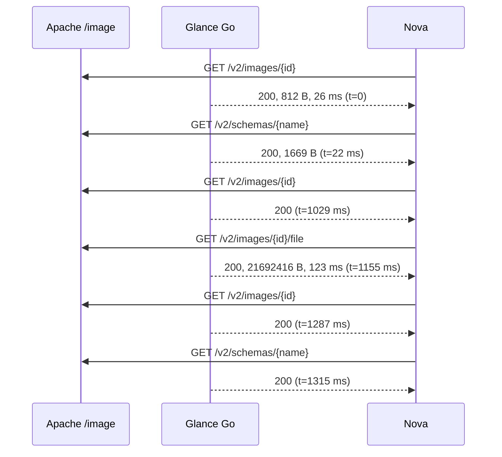

# B26 — suite Glance Go: dos corridas reales consecutivas aprobadas

Fecha local 2026-11-12 (America/Santiago), 2026-11-13 UTC en la VM.
Revisión ejecutada: `c6684fd`, que es `local/asus-lab` con la rama
`feat/glance-integration-suite` integrada. Binario `cmd/glance` estático
(`CGO_ENABLED=0`, Go 1.27.3).
Laboratorio: VM `tt-openstack-lab` local con 4 vCPU y **6 GiB**, en un host de 7 GiB.
No es el perfil de 8 GiB de las campañas.

Comando ([uso](../../../docs/glance/b26-integration-suite.md)):

```sh
python3 scripts/integration/glance_suite.py --binary bin/glance --flavor-id 42 \
  --network-id <red private> --work-root /home/stack/tt-placement-b26-<ts> \
  --output /home/stack/b26-out-<ts> --allow-mutations
```

## Resultado

| | run-1 | run-2 |
|---|---|---|
| Casos | 10/10 | 10/10 |
| Limpieza completa (sin fallback) | sí | sí |
| Nova BUILD → ACTIVE desde una imagen sólo en Go | 4,8 s | 4,4 s |
| Lecturas de metadatos de Nova (200) | 3 | 3 |
| Descarga completa de CirrOS (21 692 416 B) | 1, 123 ms en Go | 1 |
| Solicitudes no atribuibles a Nova en la ventana | 0 | 0 |

**Flujo Nova → Glance Go observado en run-2** (`flow.mmd`). Los tiempos son relativos y los IDs están anonimizados:



Las dos primeras llamadas ocurren mientras se crea el servidor y las cuatro
siguientes alrededor de un segundo después. **Por el orden temporal**, esto es
coherente con: primero nova-api (validación de la imagen) y después nova-compute
(metadatos, descarga a `_base` y relectura). No es una atribución exacta: en
este DevStack, keystoneauth registra en nivel WARN, así que no hay líneas
"used request id". La captura atribuyó cada respuesta mediante Apache
(User-Agent `python-glanceclient`). Por la misma razón, la presencia de
`X-Service-Token` queda como **desconocida** (`null`).

El descubrimiento de versiones (`GET /`) no aparece dentro de la ventana:
keystoneauth lo guarda en caché en el proceso de nova-api desde corridas
anteriores. Que funciona está probado en el caso `auth_fail_closed`, donde Go y
Python responden 300 sin token.

## Qué se corrigió para llegar aquí

Antes de este resultado hubo cuatro corridas fallidas, conservadas en
`harness/build-log.md`:

1. El control de Placement heredado exigía cero allocations. Ahora es sólo de lectura.
2. **Glance Go no tenía descubrimiento de versiones.** nova-api fallaba con `MissingAuthPlugin` y HTTP 500. Se implementó en Go.
3. La credencial de servicio de Go estaba en el proyecto de laboratorio, y Go rechazaba con 403 el `X-Service-Token` de Nova (regla documentada en `composite-auth.md`). Ahora está en el proyecto `service`, como en un despliegue real.
4. La captura tenía una ventana imprecisa, la ruta de esquemas no estaba reconocida y la atribución por Apache fallaba en empates de segundo. El control de Placement también comparaba el campo `generation`.

## Contenido

Cada `run-N/` contiene:
- `report.json`: casos, tiempos, estados, limpieza y solicitudes.
- `flow.json` y `flow.mmd`: el flujo capturado.
- `original-*.json`: catálogo de Glance Python y hash del site de Apache, antes y después.
- `placement-*/`: control de sólo lectura. `report.raw.json` es el original; `report.json` es la versión comparada, sin `generation`.
- `controls-*.json` y logs de cada acción.

No hay tokens, DSN ni credenciales. La única aparición de "password" es el
valor `auth_type: password` de la configuración leída.

## Límites

- No mide rendimiento.
- Placement fue el original de Python durante toda la prueba.
- Se usó una sola imagen CirrOS qcow2 y el backend local de Nova. No se probaron RBD ni copy-on-write.
- Nova conserva su copia de la imagen en la caché `_base` hasta que su gestor la retire.
- Hay un servidor preexistente (`b26-ubuntu-20261029a`, SHUTOFF) que no se tocó. Sus allocations se mantuvieron iguales antes y después.
